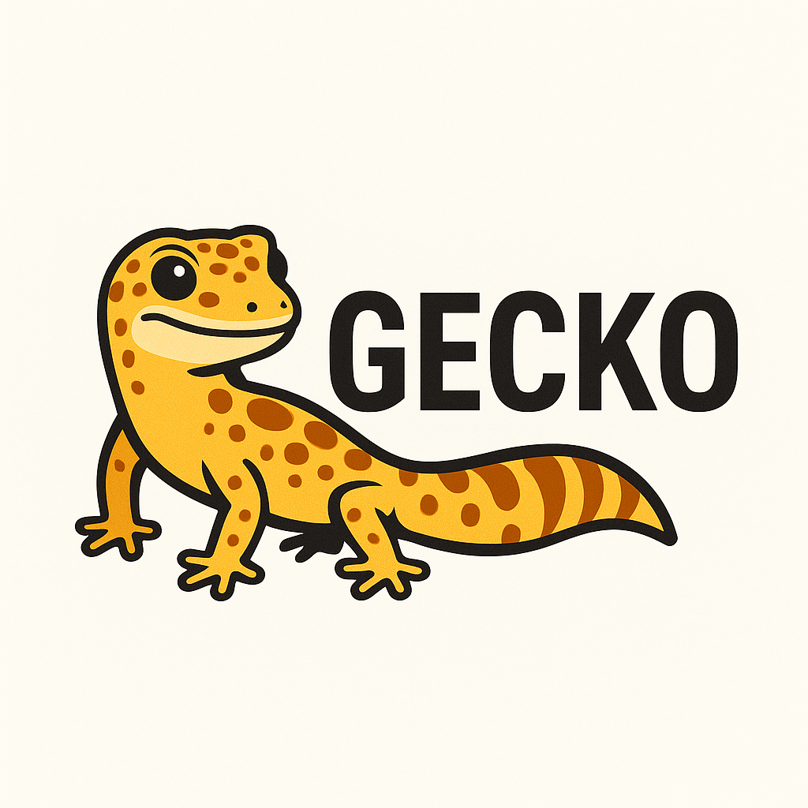

  

### The sleekest, fastest CLI dev environment you’ll ever meet.

Gecko is your all-in-one, lightning-fast development toolkit powered by the speed of **Go**. Like the animal it’s named after, it’s light, fast, and sticks everything together—**seamlessly**.

## 🔥 Why Gecko?

You know that moment when you just want to build, not fight with config files and mismatched services?  
Gecko gets it. That’s why it gives you:

- ⚡ **Blazing Fast Performance**  
  Written in Go. Starts in seconds. Stays out of your way.

- 🧩 **Complete Dev Stack in One Command**  
  Apache, MySQL, PhpMyAdmin, Ngrok, and more—already talking to each other out of the box.

- 🌍 **Zero-Pain VHost Management**  
  Create a new app and instantly access it via a custom local domain like `project.test`.

- 🛠️ **Pure CLI Experience**  
  No GUI, no bloat. Just fast, terminal-based control like the 10x dev you are.

- 🚀 **Minimal Setup, Maximum Flow**  
  One-liner to start. One-liner to deploy. Spend time coding, not configuring.

## 🧪 Built for...

- Freelancers who need fast project bootstrapping
- Teams who want consistent local setups
- Power users who live in their terminal
- Anyone tired of saying “wait, why isn’t MySQL connecting again?”

## 🙌 Contribute Like a Legend

Fork it. Build it. PR it.  
We love clean code, cool features, and passionate developers.

## 📜 License

Licensed under **GPLv3**. Read the `LICENSE` file like a responsible adult (or just start coding, we won’t judge).

---

> 🧠 Gecko isn't just a tool. It’s peace of mind in your terminal.
